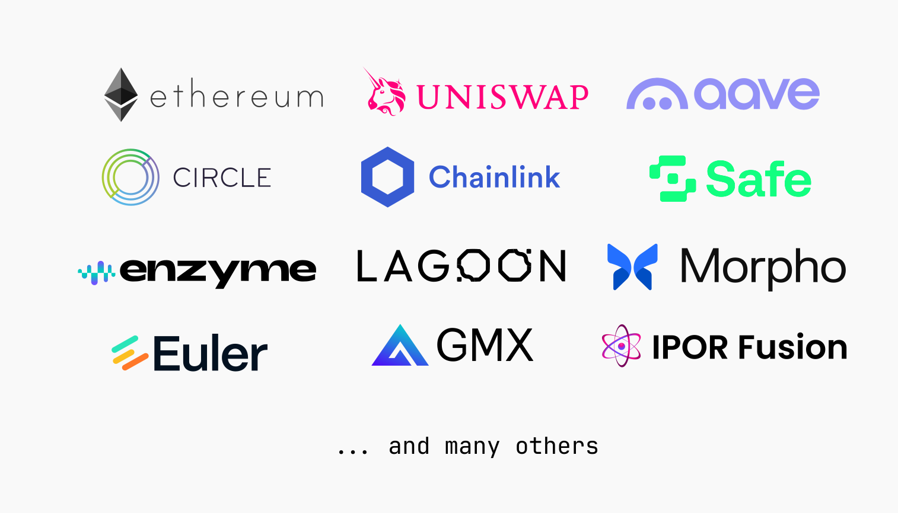

[](https://badge.fury.io/py/web3-ethereum-defi)

[](https://github.com/tradingstrategy-ai/web3-ethereum-defi/actions/workflows/test.yml)

[](https://github.com/tradingstrategy-ai/web3-ethereum-defi/actions/workflows/test-gmx.yml)


# web3-ethereum-defi

Use `eth_defi` to trade on decentralised exchanges, read onchain market data and manage vault positions from Python.

## Supported protocols, chains and integrations



| Task | Where to start |
| --- | --- |
| Swap tokens | [Uniswap v3 swap tutorial](https://web3-ethereum-defi.tradingstrategy.ai/tutorials/make-uniswap-v3-swap-in-python.html) |
| Trade perpetual futures | [GMX](https://github.com/tradingstrategy-ai/web3-ethereum-defi/blob/master/eth_defi/gmx/README.md) and [Derive](https://github.com/tradingstrategy-ai/web3-ethereum-defi/blob/master/eth_defi/derive/README-derive.md) |
| Transfer USDC between chains | [Circle CCTP](https://github.com/tradingstrategy-ai/web3-ethereum-defi/blob/master/eth_defi/cctp/README-cctp.md) |
| Discover vaults and read historical prices | [Vault protocol catalogue](https://web3-ethereum-defi.tradingstrategy.ai/vaults/index.html) |
| Check deposit and redemption support | [Vault adapter capabilities](https://github.com/tradingstrategy-ai/web3-ethereum-defi/blob/master/eth_defi/erc_4626/README-vault-protocol-support.md) |
| Check supported networks | [Chain names and identifiers](https://github.com/tradingstrategy-ai/web3-ethereum-defi/blob/master/eth_defi/chain.py) |
| Find other integrations | [Python API reference](https://web3-ethereum-defi.tradingstrategy.ai/api/index.html) |

## Prerequisites

The package declares support for Python 3.10 and later in the 3.x series. The repository uses Python 3.14 for development. Use Linux, macOS or Windows Subsystem for Linux.

## Install

```shell
pip install web3-ethereum-defi
```

For a project managed by uv or Poetry, use `uv add web3-ethereum-defi` or `poetry add web3-ethereum-defi`. For data analysis, install `web3-ethereum-defi[data]`. The [package configuration](https://github.com/tradingstrategy-ai/web3-ethereum-defi/blob/master/pyproject.toml) lists the optional dependencies for other integrations.

## Example code

### Uniswap swap example

The [Polygon swap script](https://github.com/tradingstrategy-ai/web3-ethereum-defi/blob/master/scripts/make-swap-on-uniswap-v3.py) reads token balances, asks for the amount to swap and requests confirmation before signing and broadcasting. It uses `JSON_RPC_POLYGON` for the connection and `PRIVATE_KEY` for the signing account. The [tutorial collection](https://web3-ethereum-defi.tradingstrategy.ai/tutorials/index.html) covers swaps, lending, vaults and historical data.

## Development and contributing

Follow the [development instructions](https://github.com/tradingstrategy-ai/web3-ethereum-defi/blob/master/docs/source/development.rst) to install the checkout and run focused tests. The [repository guide](https://github.com/tradingstrategy-ai/web3-ethereum-defi/blob/master/.claude/docs/README.md) links to component READMEs, test fixtures and scanner operations.

## Vault database maintenance

Use the [numbered migration runbook](https://github.com/tradingstrategy-ai/web3-ethereum-defi/blob/master/.claude/docs/migration-scripts.md#production-runbook) to stop competing writers, preview pending changes, apply them and restart the scanner.

## Version history

See the [changelog](https://github.com/tradingstrategy-ai/web3-ethereum-defi/blob/master/CHANGELOG.md) and the [releases on PyPI](https://pypi.org/project/web3-ethereum-defi/#history).

## Support

- [Join Discord for any questions](https://tradingstrategy.ai/community).

## Social media

- [Watch tutorials on YouTube](https://www.youtube.com/@tradingstrategyprotocol)
- [Follow on Twitter](https://twitter.com/TradingProtocol)
- [Follow on Telegram](https://t.me/trading_protocol)
- [Follow on LinkedIn](https://www.linkedin.com/company/trading-strategy/)

## Licence

[MIT](https://github.com/tradingstrategy-ai/web3-ethereum-defi/blob/master/LICENSE.txt).

[Created by Trading Strategy](https://tradingstrategy.ai).
