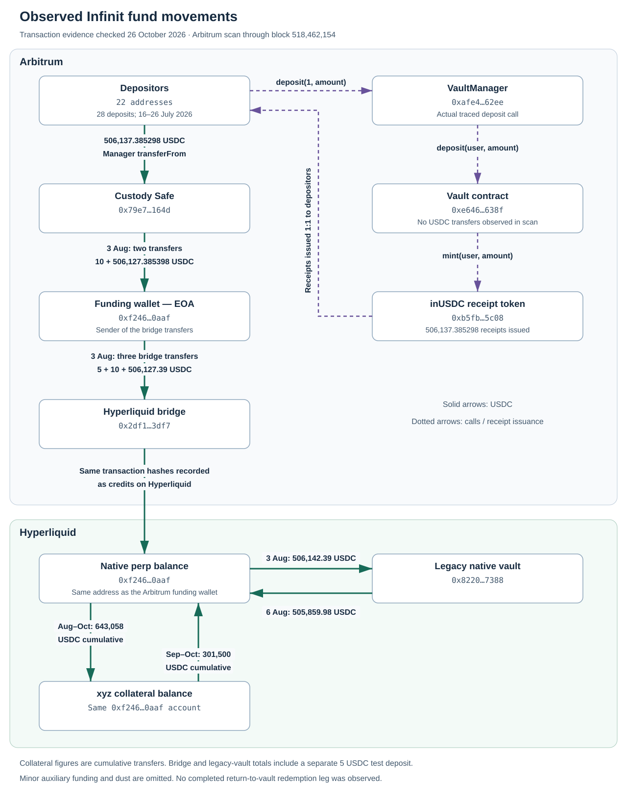

Infinit
========

`Infinit <https://www.infinit.tech/>`__ publishes the
`APEX MultiStrategy vault <https://app.infinit.tech/vaults/apex-multistrategy>`__,
managed by `Apex Quant Capital <https://www.apexquants.xyz/>`__, identified through
Infinit's manager links. Its curator metadata slug is ``apex-quants``.
Its deterministic relative-strength strategy targets matched
long and short Hyperliquid perpetual positions. The integration assigns
``Dangerous`` technical risk and supports data reads only. Transaction requests
raise ``VaultFlowUnavailable`` and public transaction capability is unavailable.
This is independent of the contract's deposit window and redemption status.

The `terms <https://docs.infinit.tech/infinit-ai-managed-trading-strategy-marketplace/vault-terms>`__
publish 2% annual management and 20% performance fees. The reviewed manager and
vault implementations contain no fee accrual or high-water-mark accounting;
collection would require external operator accounting or settlement. Whether
published unit prices reserve fees remains unknown, so investor net returns
are unavailable. Deposits closed 30 July 2026 at 10:00 UTC;
maturity is 28 October 2026 at 10:00 UTC. Redemption also requires settlement.

Reviewed identities
-------------------

All EVM contracts are on Arbitrum One. The database identity is the actual vault,
not its separately issued receipt token or manager.

===================== ============================================
Role                  Address
===================== ============================================
Vault                 0xe64655e24b66073c73300aa924cd6df5c716638f
inUSDC receipt        0xb5fb43efd9b607c6ca863a56d22c491c82275c08
Manager (vault ID 1)  0xafe480f375ebd13df703ef50b429357d29d162ee
Custody Safe          0x79e78a5a07f09c0f59f21d4b9dcc18626a0f164d
Funding/trading       0xf2460f28c9bacb35ac6fef048b661d33ad070aaf
USDC                  0xaf88d065e77c8cc2239327c5edb3a432268e5831
===================== ============================================

The application UUID is ``019f5a8e-62cf-752c-9e2f-8640768c7d3d``.
Vault creation is block 483358787, transaction
``0xbef5388cf1f6da875e50693ae33632a5d2ad3c366dd6ff802bf7d6d36cf53506``.
The `legacy Infinit Multi-Strategy vault <https://tradingstrategy.ai/vaults/infinit-multi-strategy>`__
at ``0x8220ed9e3d84da5e9d5f6d115a28a0b28b967388`` is a separate native
Hyperliquid product. The trading account temporarily invested in it between
3 and 6 August 2026, as established by the ledger entries below. The withdrawal
returned funds to the trading account on Hyperliquid, not to Arbitrum or
investors. These products retain separate identities and performance histories;
the legacy vault's returns and fees do not establish this product's investor
returns or fee terms.

The audit identifies `Saprolings/vault-contracts <https://github.com/Saprolings/vault-contracts>`__
and review commit ``d1fd00f8``. The repository returned 404 during review on
26 October 2026. The report's post-fix commit is unspecified. We cannot claim
that the deployed implementation matches that review. Verified implementation
interfaces and explorer references are in ``eth_defi/abi/infinit/README.md``.

Observed fund movements
-----------------------

The following chart reconstructs **completed transactions**, checked on
26 October 2026. Its evidence is Arbitrum transaction receipts, an actual
deposit call trace, indexed USDC and receipt-token events, and the Hyperliquid
account ledger. The flows are established from those records rather than
protocol documentation. The Arbitrum event scan covers vault deployment at
block 483358787 through block **518462154**, inclusive.

   Observed Infinit funding and collateral movements. Solid arrows represent
   USDC; dotted arrows represent contract calls or receipt issuance.

The 28 deposits from 22 addresses, between 16 and 26 July 2026, total
**506,137.385298 USDC**. Every manager deposit event matches both a USDC
transfer from that depositor to the custody Safe and an equal inUSDC mint to
the depositor in the same transaction. The traced
`205,423.352859 USDC deposit on 17 July <https://arbiscan.io/tx/0xfdd3ff949b0d367a7390b65f3f311ea19850829356a5324d1c1e93efcade5d8a>`__
shows the manager calling the vault, which calls the receipt token to mint.

On 3 August, the Safe sent
`10 USDC <https://arbiscan.io/tx/0x27d1255444d5b5bba8032998e2e5ae2a2f3b816d3698e4b33f624f9c899c9d1e>`__
and then
`506,127.385398 USDC <https://arbiscan.io/tx/0x0611b2f9dc3335a922be14eb8775e6b726c9894505b038b29058ea45735b0d94>`__
to ``0xf2460f28c9bacb35ac6fef048b661d33ad070aaf`` on Arbitrum. The successful
receipts show Safe ``execTransaction`` calls. That destination is an EOA on
Arbitrum and also identifies the separate Hyperliquid trading account.
The EOA's outgoing Arbitrum transfers are not governed by the Safe's signature
threshold. Hyperliquid account permissions operate separately; the EOA's
key-management arrangements have not been verified. The observed transactions
do not establish a completed bridge withdrawal back to Arbitrum.

The funding wallet subsequently transferred
`5 USDC <https://arbiscan.io/tx/0xede561eeee5e6bd224ebc42cb65d42b48446ac1f69c4e0e3163125e0f5bed9b1>`__,
`10 USDC <https://arbiscan.io/tx/0xe08761aec02d55e083681fa29ce8390d779b319be352f5c4aadeac7414c0529a>`__
and
`506,127.39 USDC <https://arbiscan.io/tx/0x0719cf323b9415a354187383600e52e024c07a0f60135894ff1230c0def54a05>`__
to the bridge at ``0x2df1c51e09aecf9cacb7bc98cb1742757f163df7``.
The Hyperliquid ledger records these exact transaction hashes as deposits into
the same-address account, establishing the link between the two ledgers.

Within Hyperliquid, the ledger records:

* A 5 USDC test deposit into the legacy native vault at 06:31 UTC on 3 August,
  followed by 506,137.39 USDC at 08:47 UTC. The latter action hash is
  ``0x45d1490ffbca8785474b04415876d302019500f596cda657e999f462bace616f``.
* A withdrawal of 505,859.98 USDC from that native vault at 09:34 UTC on
  6 August, action hash
  ``0x11e2e61a19026435135c044190654802018000ffb4058307b5ab916cd8063e1f``.
* Subsequent collateral transfers within the trading account: 643,058 USDC
  cumulatively from native to ``xyz``, starting 10 August, and 301,500 USDC
  cumulatively back from ``xyz`` to native, starting 18 September. These are
  sums of repeated movements, not asset valuations.

Bridge and native-vault totals include a separate 5 USDC test deposit. Minor
auxiliary funding and dust are omitted from the chart; the underlying amounts
are retained in the evidence snapshots. The scan found **no USDC transfers
involving the actual vault contract, no receipt burns and no manager withdrawal
events**. A later RPC observation at block 518462681 also returned zero USDC
in the vault. No completed return-to-vault redemption leg is shown.

Download the :download:`editable Mermaid source <fund-flow.mmd>` and the
dated public evidence snapshots:

* :download:`Verified totals and scan boundary <evidence/2026-10-26/verified-summary.json>`.
* :download:`Arbitrum indexed events <evidence/2026-10-26/arbitrum-events.json>`.
* :download:`Actual deposit call trace <evidence/2026-10-26/investor-debug-call-trace.json>`.
* :download:`Hyperliquid account ledger <evidence/2026-10-26/trading-ledger.json>`.

Prices and evidence
-------------------

The canonical price is the application's public performance history,
``PriceSource.api``. Read-only Next.js action identifiers are discovered from
the current build's public JavaScript. A changed or malformed response aborts
the read. This is an undocumented application interface and may change.

Original fifteen-minute observations and compressed raw responses remain in
unconstrained ``infinit_*`` DuckDB tables. Hourly exports retain the first actual
observation in each hour, with its original timestamp. Current metadata allows
up to thirty minutes of price age, including one interval of publication lag;
older prices produce unavailable NAV. Hypersync mint/burn logs reconstruct six-decimal inUSDC supply,
checked against onchain total supply before commit. Asset values require both
a valid source price and matching supply. Native and ``xyz`` Hyperliquid
``marginSummary.accountValue`` are used only for current valuation validation.

These inclusive UTC source intervals are quarantined:

* 30 July 2026 10:00 through 4 August 2026 01:45.
* 6 August 2026 09:30 through 27 August 2026 10:30.

No forward filling, interpolation or return calculation may bridge those gaps.
Their raw source values remain evidence. Replacing them requires an explicit
reviewed repair. Shortened or failed API responses cannot erase older context.
Future manager vault IDs are logged as unreviewed; they do not inherit Apex's
fees, identity or trading account.

Recurring all-chain scanning
----------------------------

``scripts/erc-4626/scan-vaults-all-chains.py`` includes Infinit in the Arbitrum
cycle when ``SCAN_PRICES=true``. There is no separate Infinit switch.
``SCAN_HYPERCORE`` controls native Hyperliquid vaults; ``SCAN_APEX`` controls
the unrelated ApeX exchange integration.

Like the existing GMX and Antarctic integrations, ``InfinitVault`` implements
``VaultBase`` and supplies a contextual historical reader. Discovery seeds
the reviewed deployment and classifies it by chain and address, without
depending on ERC-4626 events or valuation methods. Future deployments require
their own reviewed product mapping.

After the initial leads, metadata and history migrations, each price cycle
extends the already bootstrapped dense timestamp cache, fetches public prices
and indexed supply, and validates that supply against RPC. The shared writer
then refreshes only Infinit's retained hourly history. This small history is
replayed independently of other Arbitrum readers so delayed API observations
and retries cannot fall behind their scan position. Other vaults' prices and
reader states are preserved. Before replacing prices, the scanner requires the
context to cover every existing Infinit source timestamp in the replacement
range. If the context is lost and the API has shortened its history, restore
the context backup; the scanner refuses to erase those older prices. A failed
source read withholds Infinit from publication and logs the reason. Other
Arbitrum readers and settlement scans still run. The chain dashboard displays
an Infinit warning without imposing whole-chain RPC backoff.
Missing source coverage requires operator restoration and is logged as an error.
The shared fourteen-day source freshness audit includes Infinit's actual
observations; rewriting old rows does not make them fresh. The separate current Hyperliquid equity
check is diagnostic and never replaces historical API prices.

The address-scoped refresh uses the shared atomic Parquet writer, so it incurs
an additional read and rewrite of the shared price file. It deliberately does
not advance adaptive ERC-4626 reader state; its event cursor lives in the
context database. Source observations retain their actual dates, and stale
prices are not advanced to the current time.

Local rehearsal
---------------

Use the existing gitignored ``.local-test.env`` without editing it. It supplies
``JSON_RPC_ARBITRUM`` and ``HYPERSYNC_API_KEY``. Copy datasets into an isolated
directory before applying a rehearsal. Do not change ``HOME``.

.. code-block:: shell

   source .local-test.env
   export PIPELINE_DATA_DIR=/tmp/infinit-rehearsal
   mkdir -p "$PIPELINE_DATA_DIR"
   cp ~/.tradingstrategy/vaults/vault-metadata-db.pickle "$PIPELINE_DATA_DIR/"
   cp ~/.tradingstrategy/vaults/vault-prices-1h.parquet "$PIPELINE_DATA_DIR/"
   cp ~/.tradingstrategy/vaults/cleaned-vault-prices-1h.parquet "$PIPELINE_DATA_DIR/"
   cp ~/.tradingstrategy/vaults/vault-historical-context.duckdb "$PIPELINE_DATA_DIR/"
   cp ~/.tradingstrategy/vaults/vault-reader-state-1h.pickle "$PIPELINE_DATA_DIR/"
   export DRY_RUN=true
   poetry run python scripts/infinit/migrate-historical-leads.py
   DRY_RUN=false poetry run python scripts/infinit/migrate-historical-leads.py
   poetry run python scripts/infinit/migrate-metadata.py
   DRY_RUN=false poetry run python scripts/infinit/migrate-metadata.py
   CLEAN_PRICES=true poetry run python scripts/infinit/backfill-history.py
   DRY_RUN=false CLEAN_PRICES=true poetry run python scripts/infinit/backfill-history.py

Each dry run executes real reads and stages changes temporarily. It does not
publish datasets. Apply requires the scanner's ``scan-pipeline`` lock, writes
non-overwriting backups, validates staging and atomically replaces each file.
Publication spans multiple files; the lock prevents concurrent readers/writers
using the pipeline lock, and I/O failures trigger restoration from backups.
Interrupted processes can be recovered from those backups. Existing unreadable
Parquet is a hard error. Reader state and chain discovery cursors are untouched.

Optional overrides are ``VAULT_DB_PATH``, ``UNCLEANED_PRICE_DATABASE``,
``CLEANED_PRICE_DATABASE``, ``HISTORICAL_CONTEXT_PATH``, ``TIMESTAMP_CACHE_PATH``
(a directory), ``END_BLOCK`` (exclusive), ``MAX_WORKERS`` and ``LOG_LEVEL``.
Keep output paths on the same filesystem as the staging directory. Use
``CLEAN_PRICES=true`` only when an existing cleaned Parquet is available.

History requires dense timestamps for the requested deployment-to-end range.
The script refuses sparse coverage. Restore or prepopulate the cache first,
using an isolated directory for rehearsal:

.. code-block:: python

   from pathlib import Path
   from eth_defi.hypersync.utils import configure_hypersync_from_env
   from eth_defi.hypersync.hypersync_timestamp import fetch_block_timestamps_using_hypersync_cached

   client = configure_hypersync_from_env(42161).hypersync_client
   stamps = fetch_block_timestamps_using_hypersync_cached(
       client=client, chain_id=42161, start_block=483358787,
       end_block=505781463, cache_path=Path("/tmp/infinit-rehearsal/timestamps"),
   )
   stamps.close()

Run that snippet with ``poetry run python``. Then set
``TIMESTAMP_CACHE_PATH=/tmp/infinit-rehearsal/timestamps`` and
``END_BLOCK=505781464`` for the bounded rehearsal above. The timestamp helper's
end is inclusive, whereas the migration's end is exclusive.

Production operation
--------------------

Deployment remains an operator action. Inspect ``docker-compose.yml`` first:
``vault-scanner-oneshot`` inherits the all-chain scan entrypoint and mounts
persistent host state. Override the entrypoint explicitly. Ensure no scanner
is running a conflicting write and that the mounted dense timestamp cache is
ready before backfill. Run leads, metadata, then history, each dry run before
apply. For example, from the production checkout:

For history, explicitly set ``END_BLOCK`` to the exclusive end of the restored
dense cache (at most its last contiguous block plus one). The default RPC head
minus 64 can advance beyond that read-only cache while maintenance is running;
it is suitable only when the cache already covers that exact boundary. Pass
the same explicit end to both the dry run and apply.

.. code-block:: shell

   source ~/vault-scanner/vault-rpc.env
   docker compose run --rm --entrypoint /bin/bash vault-scanner-oneshot -lc \
     'DRY_RUN=true python scripts/infinit/migrate-historical-leads.py'

Use the same mounted one-shot service for metadata and history. Change
``DRY_RUN=false`` only after reviewing the corresponding dry run. Do not reset
chain cursors, remove reader state, change ``HOME`` or use an unmounted container.

Real integration checks
-----------------------

.. code-block:: shell

   source .local-test.env
   timeout 180s poetry run pytest tests/erc_4626/vault_protocol/test_infinit.py -q --override-ini='addopts='
   INFINIT_LIVE_TEST=true timeout 180s poetry run pytest tests/erc_4626/vault_protocol/test_infinit_live.py -q --override-ini='addopts='

The second command checks the actual public app and current account valuation.
The lead and history rehearsal commands exercise the authenticated configured
Hypersync provider. No credentials are included in output.
